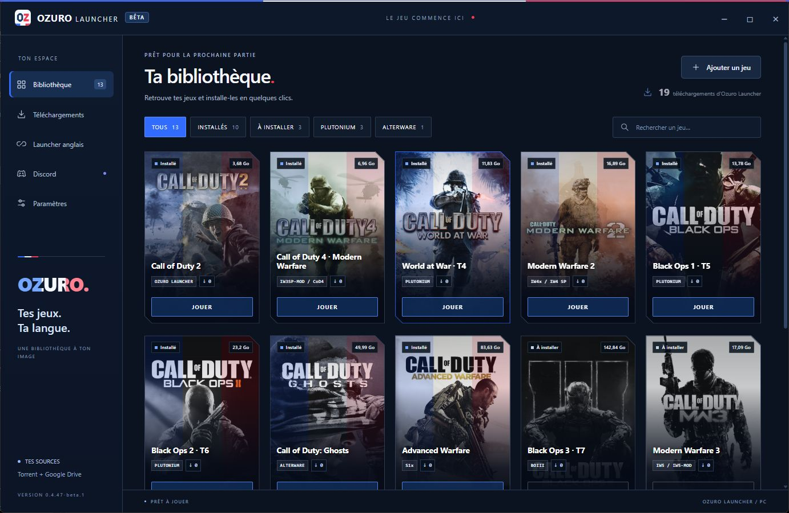

# Ozuro Launcher — Bêta

Launcher Windows en français, aux couleurs bleu, blanc, rouge.

## Télécharger

[Télécharger Ozuro Launcher 0.4.52-beta.1 pour Windows](https://github.com/matthieu545/ozuro-launcher-downloads/releases/download/v0.4.52-beta.1/Ozuro-Launcher-0.4.52-beta.1.exe).

**Version bêta — destinée aux tests.** Le fichier portable suffit ; aucun jeu n'est inclus dans l'EXE. La [page de cette préversion](https://github.com/matthieu545/ozuro-launcher-downloads/releases/tag/v0.4.52-beta.1) contient l'EXE, sa notice et son empreinte SHA-256. Les versions précédentes restent dans [Releases](https://github.com/matthieu545/ozuro-launcher-downloads/releases).

## Utiliser

1. Fermer l'ancien launcher, puis ouvrir le nouvel EXE sur Windows 10/11 x64.
2. Sélectionner un jeu et les modes souhaités.
3. Choisir son dossier d'installation, puis démarrer le téléchargement.
4. Une fois l'installation terminée, choisir le mode et cliquer sur Jouer.

Les préférences restent dans le dossier historique **%APPDATA%\FR Launcher** et les jeux déjà installés sont conservés. Les téléchargements dépendent de la disponibilité des sources et des joueurs qui partagent les fichiers. Les prérequis Microsoft manquants sont détectés par le launcher ; Windows peut demander une autorisation pour les installer.

## Nouveautés depuis la 0.4.36

- Version installée visible en haut, à côté du badge BÊTA.

- Moteur Ozuro Partage indépendant : les fichiers déjà installés continuent d’être partagés après fermeture ou arrêt forcé du launcher. L’icône près de l’horloge et le bouton des paramètres permettent de l’arrêter.
- Envoi illimité par défaut pour les nouveaux profils. Les limites déjà choisies restent conservées ; l’option Illimité est disponible dans les paramètres.

- Correction de « Redirect was cancelled » lors de la mise à jour : les redirections GitHub sont suivies après validation de chaque destination.

- Correctif de connexion au tracker privé : les annonces du moteur torrent passent en IPv4, le protocole accepté par le tracker actuel.
- Mises à jour automatiques du launcher au démarrage : téléchargement depuis le dépôt officiel, vérification SHA-256 et redémarrage automatique. Les jeux et les réglages sont conservés. Les utilisateurs des versions jusqu’à la 0.4.48 doivent ouvrir une fois cette version manuellement pour corriger leur ancien mécanisme de mise à jour.
- Bibliothèque avec jaquettes haute définition, recherche et filtres. Les jeux à installer sont grisés ; les jeux installés ont un voile bleu, blanc, rouge et un contour bleu au survol.
- Choix des modes disponibles lors de l'installation et possibilité de retirer un mode pour récupérer de l'espace, tout en conservant les fichiers partagés et personnels. La campagne de Call of Duty 4 est proposée séparément du multijoueur.
- Affichage du volume à télécharger et de l'espace disque disponible dans le dossier choisi.
- Détection automatique d'une source qBittorrent sur le même PC.
- Partage torrent après installation, activé par défaut pour les nouveaux profils. Un choix existant est conservé ; l'option peut être désactivée dans Paramètres et le partage arrêté par jeu dans Téléchargements. Le moteur indépendant garde une icône près de l’horloge et continue après fermeture du launcher.
- Onglet Discord avec lien vers la communauté et estimations des membres et membres en ligne, actualisées chaque minute.
- Compteur des téléchargements Windows du launcher et petites vignettes par jeu pour les installations terminées signalées depuis la 0.4.45. Les réparations ne recomptent pas la même installation ; les anciens téléchargements des jeux ne sont pas reconstitués.
- Nom complet « Ozuro Launcher » dans les actualités et le total ; vignette MW3 « IW5 / IW5-MOD ».

Le tracker reste hébergé sur Cloudflare Workers en HTTPS. Les fichiers s'échangent directement entre participants ; Cloudflare ne les transporte pas. Les participants voient l'adresse de sortie des clients torrent. Voir [les détails de sécurité et des compteurs](SECURITE.md).

## Vérifier le fichier

L'empreinte SHA-256 figure dans [SHA256SUMS.txt](SHA256SUMS.txt) et avec la préversion.

## À propos de ce dépôt

Ce dépôt public distribue uniquement l'application et sa notice. Le dépôt de développement est privé. Les jeux, sauvegardes, configuration du tracker et catalogue opérationnel ne sont pas hébergés comme fichiers sources ici. Un utilisateur disposant de l'EXE peut en extraire les sources de téléchargement.
